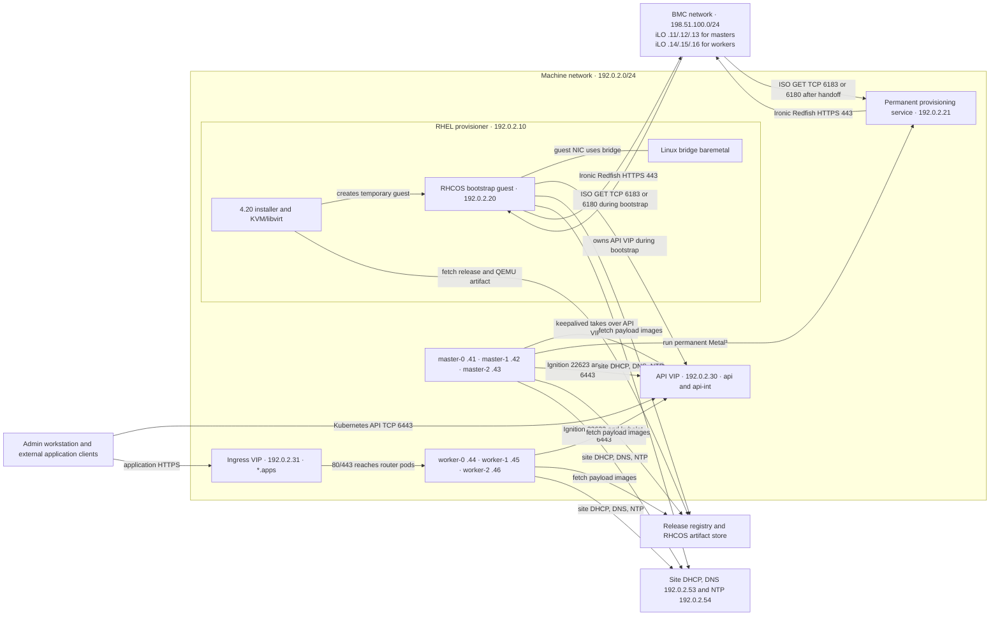
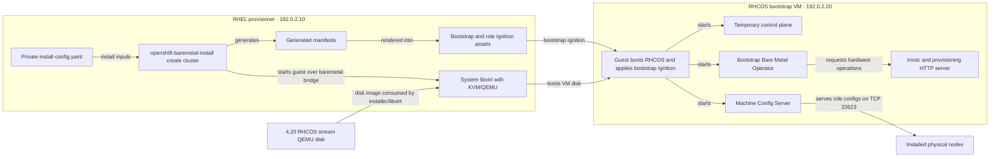
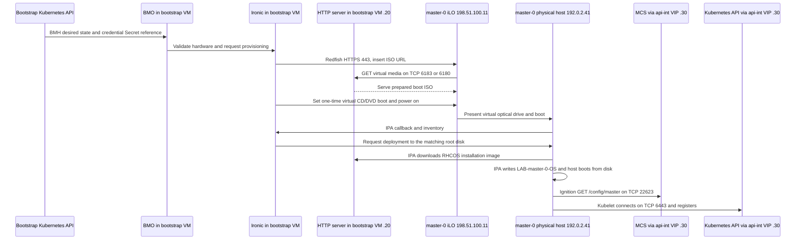
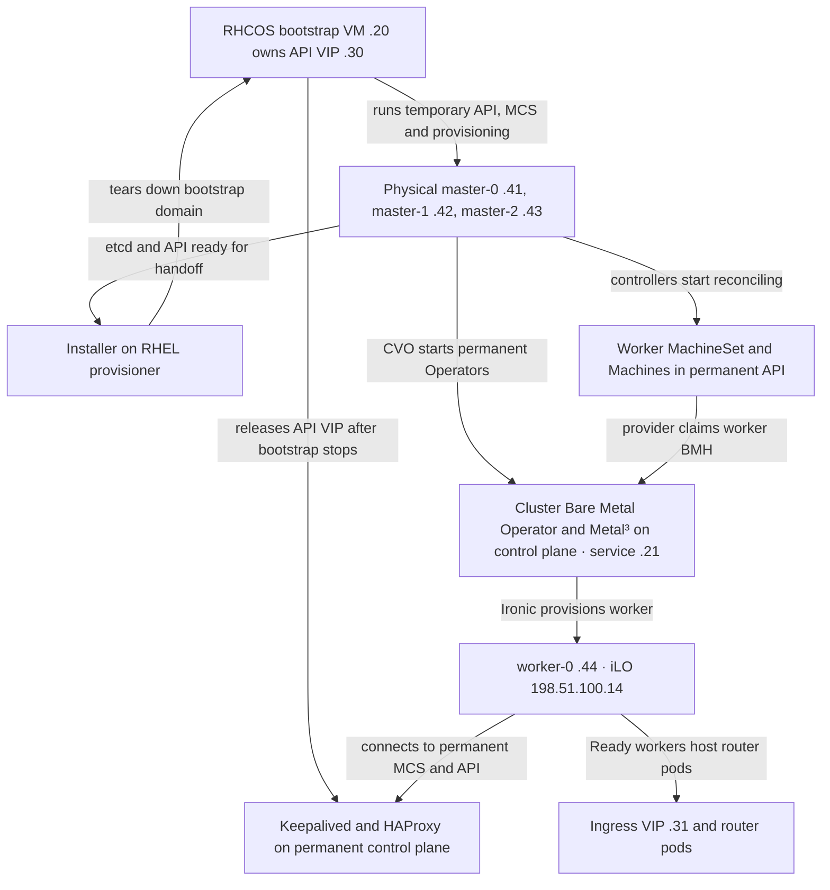

# Editable Mermaid diagrams

Edit the Mermaid blocks directly in this file. The addresses match the [inventory](../config/inventory.yaml). Arrows show the request initiator, information flow, or action named on the connection.

## Topology

## Bootstrap VM

## Redfish and IPA

## Bootstrap handoff

## Virtualization enablement

```mermaid
flowchart LR
    admin["Cluster admin · workstation"]
    accepted["Accepted OCP 4.20 base cluster"]
    olm["OLM in cluster · openshift-cnv subscription"]
    hco["HyperConverged Operator · openshift-cnv"]
    components["KubeVirt, CDI and supporting operands"]
    storage["CSI backend and PVC on eligible workers"]
    vm["Guest in virt-launcher on worker-0 .44"]
    target["Eligible worker-1 .45 or worker-2 .46"]
    route["Service and Route · virt-smoke namespace"]
    accepted -->|base platform gate| admin
    admin -->|apply Namespace, OperatorGroup, Subscription| olm
    olm -->|resolves 4.20 Operator CSV| hco
    admin -->|after CSV succeeds, apply HyperConverged CR| hco
    hco -->|reconciles| components
    components -->|CDI imports guest disk| storage
    components -->|KubeVirt schedules and starts| vm
    storage -->|provides persistent root disk| vm
    vm -->|eligible live migration with shared storage| target
    route -->|stable client endpoint forwards to guest| vm
    route -->|after migration forwards to guest| target
```

The stage breakdown and diagrams use the supplied reference material. See [source corrections](../runbooks/validation.md#reference-review) for details.
